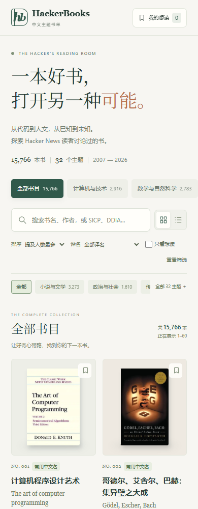

<p align="center">
  
</p>

<h1 align="center">HackerBooks · 中文主题书单</h1>

<p align="center">从代码到人文，让好奇心带路。</p>

<p align="center">
  <a href="https://passionyoungz.github.io/HackerBooks/">打开在线书架</a> ·
  <a href="https://passionyoungz.github.io/HackerBooks/index.html">单文件 HTML</a> ·
  <a href="COPY.md">项目介绍与分享文案</a> ·
  <a href="SOURCES.md">数据与译名说明</a>
</p>

把 Hacker News 读者讨论过的 **15,766 本书**，整理成一个保留原名、按主题浏览的中文书架。从计算机、数学、创业，走到历史、哲学与文学，找到下一本值得深入阅读的书。

这是一份基于 [HackerBooks](https://hackerbooks.org/#/) 数据快照的独立中文整理版。**提及热度不等于推荐票数**，它帮助发现书目，不替你判断一本书的价值。

## 你可以做什么

- **按主题逛书架**：9 个大类、32 个细分主题，允许一书多类。
- **搜索中文名和原名**：也支持作者及源站记录的 SICP、DDIA 等简称。
- **看封面，切换视图**：14,456 个条目关联版本封面，支持书架和列表两种布局。
- **完整查看书目信息**：详情中保留原名、作者、出版年份、别名，以及原站讨论和书目资料链接。
- **维护自己的想读清单**：标记保存在本机浏览器，支持 JSON 导入、导出备份。
- **下载后离线浏览**：书目、样式和脚本均嵌入同一份 HTML；搜索与筛选无需联网，封面图片需要联网。

无需注册、无需后端、无需安装前端依赖。

## 页面预览


<details>
<summary>查看手机界面</summary>



</details>

## 译名与封面的边界

本次目录快照日期为 **2026-11-02**，并非自动更新的实时榜单。

| 项目 | 数量 | 说明 |
| --- | ---: | --- |
| 完整书目 | 15,766 | 按原站作品 ID 保留，未擅自合并同书的不同条目 |
| 常用中文名 | 559 | 人工整理的常用书名，不指定出版社或 ISBN 版本 |
| 中文条目名 | 191 | 辅助匹配对应的中文维基百科条目，可能存在地区译名差异 |
| 机器暂译 | 14,988 | 未确认通行中文版本名称，明确标注为暂译 |
| 保留原名 | 28 | 技术专名、纯数字标题等 |
| 关联封面 | 14,456 | 原站提供 13,983 个，按作品 ID 补充 473 个版本封面 |
| 暂无封面 | 1,310 | 显示清晰标注的排版占位图，不伪造出版封面 |

封面可能是外文版本。原站的作品匹配、作者、年份或分类也可能存在误差。发现中文书名或作品信息有误，欢迎提交 Issue，并附上作品 ID、作者与可靠来源。

## 本地使用

下载 [`docs/index.html`](docs/index.html)，用浏览器打开即可。想读标记保存在当前浏览器的 `localStorage` 中，移动文件、更换浏览器或清除站点数据后可能不同，请使用导出功能备份。

也可以在仓库根目录运行：

```bash
python -m http.server 8000 --directory docs
```

然后打开 `http://localhost:8000`。

## 修改与构建

只需 Python 3，构建过程不联网、不使用第三方 Python 包。

```bash
python scripts/build.py
python scripts/build.py --check
```

```text
data/                  中文目录、主题、大类与快照元数据
src/                   HTML 模板、样式、交互脚本和来源说明
scripts/build.py       生成、校验可独立运行的 HTML
docs/index.html        GitHub Pages 页面，也是可下载的单文件版本
docs/assets/           项目封面、预览截图和图标
branding/              封面设计提示词与生成说明
COPY.md                可直接使用的项目介绍与分享文案
SOURCES.md             数据来源、匹配方式与权利说明
```

改动 `src/` 或 `data/` 后重新构建，并将生成的 `docs/index.html` 一起提交。仓库内的 [Pages 工作流](.github/workflows/pages.yml) 会在推送 `main` 时校验生成文件，并将 `/docs` 目录自动发布到 GitHub Pages。

## 致谢与授权

感谢 [HackerBooks / roansh](https://hackerbooks.org/#/about)、[Hacker News](https://news.ycombinator.com/) 与 [Open Library](https://openlibrary.org/)。本项目不隶属于上述网站或 Y Combinator。

原创代码以 [MIT License](LICENSE) 提供。第三方书目元数据、书名、评论、封面和截图内的出版物图像不纳入本项目的 MIT 授权，仍遵循各自来源的权利及使用条款，详见 [SOURCES.md](SOURCES.md)。项目宣传封面使用 imagegen 生成，设计提示词保存在 [`branding/cover-prompt.txt`](branding/cover-prompt.txt)。
